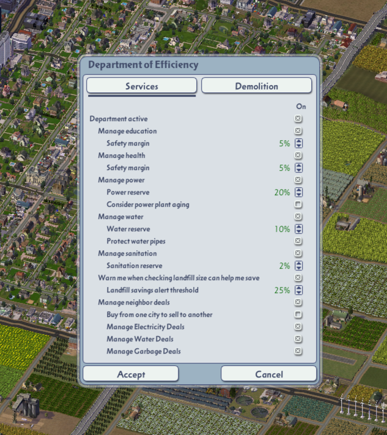
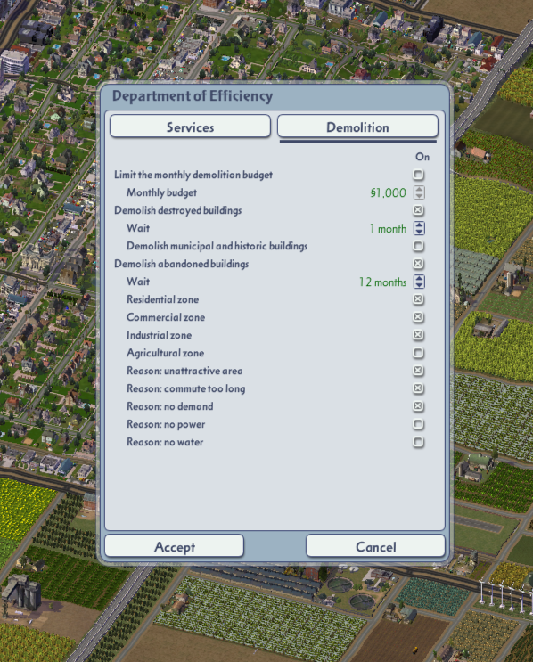
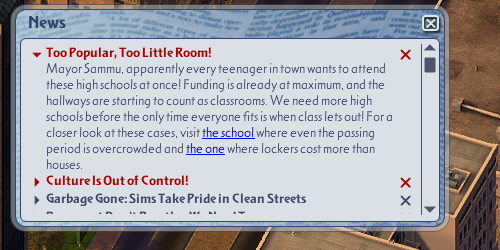
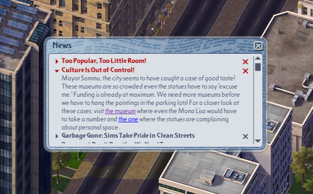
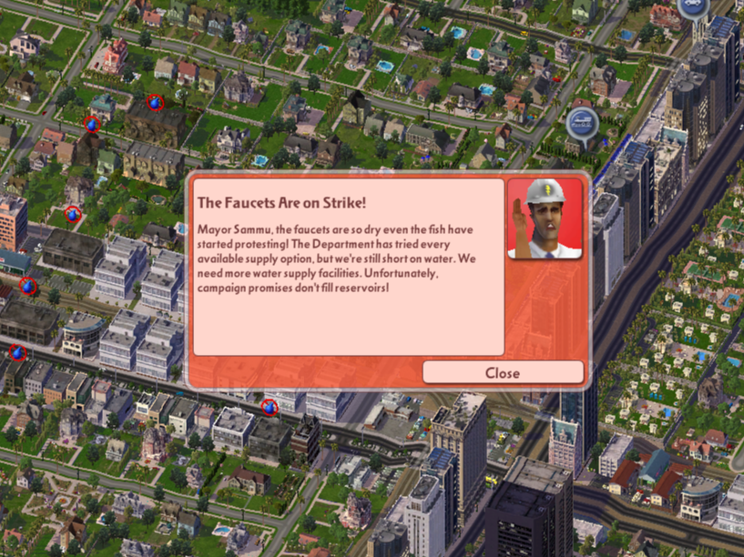
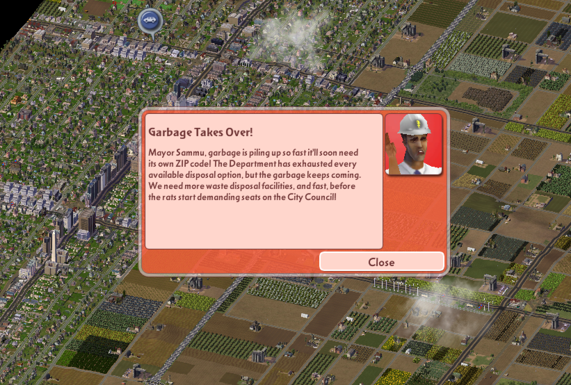

[English](README.md) | [Português](README.pt.md) | [Français](README.fr.md) | [Deutsch](README.de.md) | [Español](README.es.md) | [Italiano](README.it.md) | [Nederlands](README.nl.md) | [Dansk](README.da.md) | **Svenska** | [Polski](README.pl.md)

# Effektivitetsdepartementet

**Effektivitetsdepartementet tar hand om de små detaljerna i stadens skötsel som gör stor skillnad.**

Effektivitetsdepartementet (*Department of Efficiency* på engelska) är ett tillägg för **SimCity 4 Deluxe** som automatiserar rutinuppgifter i stadens skötsel, så att du kan koncentrera dig på att bygga, planera och låta din stad växa.

**Du bygger staden. Departementet optimerar budgeten!**

Det sköter budgeten för enskilda utbildnings- och vårdbyggnader, kraftverk, finansieringen av vatten och sophantering, avtal med grannstäder och, som tillval, rivning av ruiner och övergivna byggnader. Målet är att täcka stadens behov utan att spendera mer än nödvändigt, medan du själv bestämmer var byggnaderna placeras, täckningen och de stora planeringsbesluten.

Allt styrs inne i spelet under **Spelalternativ → Effektivitetsdepartementet**. Välj vilka tjänster som ska automatiseras, justera deras säkerhetsmarginaler, ställ in rivningen eller stäng av hela Departementet. Du kan också använda stadens förordning **Inrätta ett effektivitetsdepartement** som huvudströmbrytare. Inget separat program behövs.

> [!IMPORTANT]
> **Departementet startar påslaget, inklusive automatisk rivning av förstörda och övergivna byggnader.** Gå igenom inställningarna innan du öppnar en stad som du bryr dig om. Det gör verkliga ändringar i spelet: finansiering, avtal och rivningar sparas om du sparar staden. Det redigerar inte sparfiler direkt.

## Innehåll

- [Vad Departementet gör](#features)

- [Första inställningen](#first-time-setup)

- [Inställningar](#settings-explained)

- [Skärmbilder](#screenshots)

- [Krav och kompatibilitet](#requirements-and-compatibility)

- [Hämtning och installation](#download-and-installation)

- [Uppdatera och avinstallera](#updating-and-uninstalling)

- [Kända begränsningar](#known-limitations)

- [Tack till](#credits)

<a id="features"></a>

## Vad Departementet gör

Tabellen nedan beskriver vad Departementet gör. För formler, exempel, skyddsåtgärder och mekaniken bakom besluten, se den **[utförliga funktionsreferensen (på engelska)](features/en.md)**.

| Område | Vad det gör |
|---|---|
| [Utbildning och sjukvård](features/en.md#education-healthcare) | Justerar finansieringen **byggnad för byggnad** för lämpliga skolor, universitet, bibliotek, museer, kliniker och sjukhus. Det följer verklig beläggning och kapacitet, med en säkerhetsmarginal. Det **ändrar inte täckningsradier** eller finansieringen av skolbussar och ambulanser. Om en byggnad fortfarande är överfull vid maximal finansiering meddelar en rådgivare att ytterligare en anläggning behövs; **du väljer var den ska ligga**. |
| [El](features/en.md#electricity) | Sköter **varje kraftverk för sig** och väljer den finansiering som täcker stadens behov och säkerhetsreserven till lägsta modellerade kostnad. Det tar hänsyn till kraftverkens verkningsgrad och skick; en valfri inställning räknar också med de ekonomiska kostnaderna för kraftverkens åldrande. |
| [Vatten](features/en.md#water) | Justerar stadens vattenfinansiering så att den täcker behovet plus en säkerhetsreserv. Skydd av vattenledningarna är påslaget som standard för att undvika nedskärningar som skulle låta nätet förfalla. Det döljer också spelets vilseledande ikon „inget vatten“ över gårdar. |
| [Sophantering](features/en.md#garbage-landfills) | Justerar finansieringen av sophanteringen utifrån sopproduktion, återvinning, behandling, soptippens lagringsutrymme och regionala avtal, samtidigt som stadens eget behov av bortskaffning skyddas. |
| [Grannavtal](features/en.md#neighbor-deals) | Kan **köpa eller sälja el och vatten**, **betala grannar för att ta emot ditt avfall** eller **ta emot deras mot betalning**. Det skapar, justerar och säger upp lämpliga avtal när det samlade resultatet gynnar staden och dess egna behov och reserver förblir skyddade. |
| [Automatisk rivning](features/en.md#demolition) | Kan som standard röja ruiner efter ungefär **30 simulerade dagar** och lämpliga byggnader som varit övergivna i **ett simulerat år**. Du bestämmer vilka zoner och vilka orsaker till övergivenhet som räknas, om skyddade ruiner får röjas och om en månatlig utgiftsgräns ska gälla. |
| [Rådgivarnas meddelanden](features/en.md#notices) | Använder spelets egna rådgivare för att flagga styrkta, ihållande brister som varken finansiering eller tillgängliga avtal kan åtgärda. Där det passar innehåller meddelandena länkar som tar dig till de berörda byggnaderna. |
| [Råd om soptippens storlek](features/en.md#garbage-landfills-advice) | Det valfria rådet pekar ut en bestämd utvidgning av soptippen, eller en säker minskning, som kan sänka sophanteringsräkningen med mer än din valda spargräns. **Departementet ger råd; du avgör om zonindelningen ska ändras.** |
| [Reparation av spökrutor](features/en.md#ghost-squares) | När skötseln av sophanteringen är påslagen repareras lämpliga osynliga soptippsrutor som spelet fortfarande räknar med i underhållet, på ett säkert sätt. Osäkra eller overifierade fall lämnas ifred; det finns ingen separat strömbrytare för den här reparationen. |

Du styr fortfarande över byggande, zonindelning, skatter, vägar och transporter, polis, brandkår och alla andra tjänster som Departementet inte sköter. Om du slår på skötseln av en typ av grannavtal kan Departementet också ändra eller säga upp ett avtal som du tidigare gjort för hand. Stäng av det avtalsalternativet om du vill sköta de avtalen själv.

<a id="first-time-setup"></a>

## Första inställningen

Departementet använder de inställningar som följer med tillägget och **börjar arbeta automatiskt**. Du behöver inte slå på det, men du bör gå igenom vad det får göra innan du använder en viktig sparad stad.

1\. Starta SimCity 4 och öppna från **regionvyn** **Spelalternativ → Effektivitetsdepartementet**. Om du vill kan du använda en ny eller engångsstad för en första titt.

2\. På sidan **Samhällsservice** väljer du vilka budgetar och grannavtal Departementet får sköta och hur mycket reservkapacitet det ska hålla.

3\. På sidan **Rivning** kontrollerar du reglerna för röjning av ruiner och övergivna byggnader. **Stäng av den automatiska rivningen om du vill jämna allt med marken själv.**

4\. Klicka på **Godkänn** för att spara dina val. **Avbryt** stänger fönstret utan att spara ändringar.

5\. Öppna den stad du vill spela. Departementet följer dina sparade inställningar och sköter staden medan simuleringen pågår.

Dina inställningar lagras i tilläggets INI-filer och återanvänds när du öppnar en annan stad. Departementet bygger **inte** skolor, sjukhus, kraftverk eller vattenanläggningar åt dig. När finansiering och tillgängliga avtal inte kan lösa en styrkt, ihållande brist talar en rådgivare i spelet om var mer kapacitet behövs.

Du kan också slå på eller stänga av Departementet via stadens förordningar.

<a id="settings-explained"></a>

## Inställningar

Öppna **Spelalternativ → Effektivitetsdepartementet**. Fönstret har två sidor, **Samhällsservice** och **Rivning**. Tabellerna nedan täcker **alla inställningar som visas i menyn**, utan de tekniska formlerna. Klicka på ett alternativs namn för att läsa hela förklaringen i [funktionsreferensen](features/en.md#options).

**Så fungerar reglagen:** „På“ betyder att Departementet får sköta den funktionen. En inställning som beror på en annan är nedtonad så länge den överordnade är avstängd. Procentinställningar styr säkerhetsmarginaler och gränsvärden och hjälper Departementet att hålla reservkapacitet och hantera svängningar i efterfrågan.

### Samhällsservice

| Alternativ | Standard | Vad det betyder |
|---|---|---|
| [Departementet aktivt](features/en.md#opt-master) | **På** | Huvudströmbrytare för finansiering, grannavtal, rivning och Departementets meddelanden. Att stänga av det ångrar inte ändringar som redan gjorts. |
| [Sköt utbildningen](features/en.md#opt-education) | **På** | Justerar automatiskt lämpliga skolor, universitet, bibliotek och museer en och en. Ändrar varken deras täckning eller finansieringen av skolbussar. |
| [Säkerhetsmarginal (utbildning)](features/en.md#opt-educationreserve) | **5 %** (0–50 %) | Extra kapacitet utöver utbildningens nuvarande användning. Mer kapacitet kostar mer. För byggnader med låg beläggning kan Departementet hålla en extra marginal. Det kan till exempel låta en skola växa från 10 till 20 elever (+100 %) utan strejk, särskilt i början när merkostnaden är liten. |
| [Sköt sjukvården](features/en.md#opt-health) | **På** | Justerar automatiskt lämpliga kliniker, sjukhus och andra stödda vårdbyggnader en och en. Ändrar varken ambulansernas finansiering eller täckningen. |
| [Säkerhetsmarginal (sjukvård)](features/en.md#opt-healthreserve) | **5 %** (0–50 %) | Fungerar på samma sätt som utbildningens säkerhetsmarginal. |
| [Sköt elförsörjningen](features/en.md#opt-power) | **På** | Justerar finansieringen av enskilda kraftverk för att leverera tillräckligt med el till lägsta modellerade kostnad. |
| [Elreserv](features/en.md#opt-powerreserve) | **20 %** (10–50 %) | Reservproduktionskapacitet för den del av efterfrågan som täcks lokalt; större reserver ger mer utrymme för snabb tillväxt och minskar risken för strömavbrott, men kan kosta mer. |
| [Ta hänsyn till kraftverkens åldrande](features/en.md#opt-poweraging) | **Av** | Räknar med den uppskattade kostnaden för kraftverkens slitage och åldrande i optimeringen. Kan gynna högre finansiering när den långsiktiga vinsten av att bevara kraftverket överstiger den extra driftkostnaden. |
| [Sköt vattenförsörjningen](features/en.md#opt-water) | **På** | Justerar vattenverkets finansiering för att förse staden utan onödiga utgifter. |
| [Vattenreserv](features/en.md#opt-waterreserve) | **10 %** (10–50 %) | Fungerar på samma sätt som elreserven. |
| [Skydda vattenledningarna](features/en.md#opt-waterpipes) | **På** | Håller finansieringen på eller över spelets 50 % för att undvika skador på ledningsnätet. |
| [Sköt sophanteringen](features/en.md#opt-sanitation) | **På** | Justerar sophanteringens finansiering för att täcka behovet av insamling och bortskaffning. Reparerar också spökrutor (ett fel i spelet som tar ut underhåll för soptippsrutor som inte längre är zonade). |
| [Reserv för sophantering](features/en.md#opt-sanitationreserve) | **2 %** (2–20 %) | Extra behandlingskapacitet för stadens sopor, utöver det den producerar efter återvinning och eventuell eftersläpning. |
| [Varna mig när soptippens storlek kan spara pengar](features/en.md#opt-landfilladvice) | **Av** | Slår på det valfria rådet om ändringar i soptippens zonindelning när det sparar pengar och stadens sopor ändå hanteras. Kräver att sophanteringen sköts. |
| [Spargräns för soptippsmeddelanden](features/en.md#opt-landfillthreshold) | **25 %** (20–50 %) | Ber dig bara överväga en ändring av soptippens storlek om den modellerade månatliga besparingen uppgår till minst denna andel av sophanteringsbudgeten. |
| [Sköt grannavtal](features/en.md#opt-deals) | **På** | Slår på automatiska regionala avtal; de tre enskilda reglagen nedan avgör vilka resurser som får handlas. |
| [Köp från en stad och sälj till en annan](features/en.md#opt-arbitrage) | **Av** | Tillåter lönsamma kombinationer av köp och försäljning av samma resurs mellan grannar, med stadens egna behov främst. |
| [Sköt elavtal](features/en.md#opt-tradepower) | **På** | Låter Departementet skapa, ändra eller säga upp **import och export** av el. Oberoende av finansieringen av kraftverken. |
| [Sköt vattenavtal](features/en.md#opt-tradewater) | **På** | Låter Departementet skapa, ändra eller säga upp **import och export** av vatten. Oberoende av vattenfinansieringen. |
| [Sköt sopavtal](features/en.md#opt-tradegarbage) | **På** | Låter Departementet ordna sopbehandling **i båda riktningarna**. Oberoende av sophanteringens finansiering. |

### Rivning

| Alternativ | Standard | Vad det betyder |
|---|---|---|
| [Riv förstörda byggnader](features/en.md#opt-demolishdestroyed) | **På** | River ruiner efter en viss tid. Röjer inte automatiskt skyddade kommunala eller historiska ruiner om inte alternativet nedan tillåter det. |
| [Väntetid (förstörda byggnader)](features/en.md#opt-destroyedmonths) | **1 månad** (1–24) | Hur länge ruiner måste ligga kvar innan de kan röjas; som standard ungefär **30 simulerade dagar**. |
| [Riv förstörda kommunala och historiska byggnader](features/en.md#opt-demolishmunicipal) | **Av** | Om påslaget röjs efter väntetiden även lämpliga **ruiner** av kommunala, speciella och historiska byggnader. |
| [Riv övergivna byggnader](features/en.md#opt-demolishabandoned) | **På** | Röjer lämpliga övergivna byggnader efter väntetiden, i de valda zontyperna och av de valda orsakerna. |
| [Väntetid (övergivna byggnader)](features/en.md#opt-abandonedmonths) | **12 månader** (1–60) | Hur länge en byggnad måste stå övergiven innan den får rivas; som standard ett simulerat år. |
| [Bostadszon](features/en.md#opt-zoneresidential) | **På** | Omfattar övergivna hus och flerbostadshus. |
| [Handelszon](features/en.md#opt-zonecommercial) | **På** | Omfattar övergivna butiker och kontor. |
| [Industrizon](features/en.md#opt-zoneindustrial) | **På** | Omfattar övergivna fabriker och andra industribyggnader. |
| [Jordbrukszon](features/en.md#opt-zoneagriculture) | **Av** | Omfattar övergivna gårdar. Avstängd som standard eftersom tomma eller övergivna rutor på en gård kan vara normala. |
| [Orsak: oattraktivt område](features/en.md#opt-reasonlowdesirability) | **På** | Omfattar övergivenhet som beror på låg attraktivitet, till exempel föroreningar eller brist på service. |
| [Orsak: för lång arbetsresa](features/en.md#opt-reasoncommute) | **På** | Omfattar övergivenhet som beror på alltför långa resor till arbetet. |
| [Orsak: ingen efterfrågan](features/en.md#opt-reasonlowdemand) | **På** | Omfattar byggnader som övergivits för att efterfrågan på den typen har försvunnit. |
| [Orsak: ingen el](features/en.md#opt-reasonnopower) | **Av** | Omfattar som tillval byggnader som övergivits på grund av elbrist. Oftast är det bättre att först återställa elen och se om byggnaden fylls på igen. |
| [Orsak: inget vatten](features/en.md#opt-reasonnowater) | **Av** | Omfattar som tillval byggnader som övergivits på grund av vattenbrist. Oftast är det bättre att först återställa vattnet och se om byggnaden fylls på igen. |
| [Begränsa den månatliga rivningsbudgeten](features/en.md#opt-budgetlimit) | **Av** | Sätter ett valfritt utgiftstak för automatisk rivning, utöver de medel som finns i stadens kassa. |
| [Månadsbudget](features/en.md#opt-demolitionbudget) | **§1 000** (§0–§200 000) | Högsta rivningsutgift per simulerad månad **när budgetgränsen är påslagen**. |

<a id="screenshots"></a>

## Skärmbilder

Alla skärmbilder visar den engelska versionen av spelet.

| | |
|---|---|
|  |  |
| *Sidan Samhällsservice: varje tjänst, dess reserv och grannavtalen.* | *Sidan Rivning: ruiner, övergivna byggnader och månadsbudgeten.* |
|  |  |
| *Skolor vid maximal finansiering och fortfarande överfulla: meddelandet länkar till byggnaderna.* | *Detsamma för museer.* |
|  |  |
| *Vatten: Departementet kan inte lösa bristen med den tillgängliga försörjningen.* | *Sopor: staden behöver mer kapacitet för bortskaffning.* |

<a id="requirements-and-compatibility"></a>

## Krav och kompatibilitet

- **SimCity 4 Deluxe, Steam-utgåvan, spelversion 1.1.641.0, på Windows.** Det är den version som stöds; Departementet förblir inaktivt på andra versioner.

- **Ingen annan mod, installationsprogram eller extern applikation behövs.**

- **Testad och kompatibel med dessa moddar** (testade versioner):

  - Network Addon Mod (NAM) — 1.3.1
  - Colossus Addon Mod (CAM) — 3.1.1
  - SC4 System Integration Module — 4.0.1
  - CAM Ordinances — 3.3.0
  - Industrial Revolution Mod (IRM) — 2.0.0
  - Colossus Farming
  - Advanced Water Management — 1.0
  - SC4Fix — 1.0.0.7
  - More Building Styles — 3.6.1
  - More Demand Info — 1.3.1
  - Custom Budget Departments — 1.1
  - Custom Ordinance Host — 1.0.1
  - Legalize Gambling Ordinance Upgrade — 1.0.0
  - Lua Sandbox — 1.0.0
  - Lua Extensions — 1.5
  - Query Tool UI Extensions — 2.7.1
  - Resource Loading Hooks — 2.0.1
  - Transparent Texture Fix — 1.0.0
  - I-R Fix — 1.0.0
  - Universal Commercial Cap Fix — 2.0.0
  - Save Warning — 1.0
  - Zoning Mod Maxis — 2.0.0
  - Maxis Prop Names and Query Fix — 2.0
  - Seasonal Flora Patch — 2.1
  - No Maxis I-D, I-M e I-HT — 2.0

- **Rekommenderat:** lägg till `-CPUCount:1` under **Steam → Bibliotek → SimCity 4 Deluxe → Egenskaper → Startalternativ**. Det förbättrade stabiliteten i långa sessioner på skaparens dator.

- **Tio språk i spelet:** engelska, portugisiska, franska, tyska, spanska, italienska, nederländska, danska, svenska och polska. Departementet följer automatiskt spelets språk.

<a id="download-and-installation"></a>

## Hämtning och installation

1\. Öppna projektets **Releases**-sida (`<PUBLIC-REPOSITORY-URL>/releases`) och välj den senaste utgåvan. Ersätt platshållaren med det offentliga arkivets adress innan publicering.

2\. Under **Assets** hämtar du **distributions-ZIP:en för Department of Efficiency**.

3\. **Stäng SimCity 4.** Packa upp ZIP-filen i en tillfällig mapp.

4\. Kopiera **`DepartmentEfficiency.dll`** och hela mappen **`Department of Efficiency`** till roten av `Dokument\SimCity 4\Plugins`.

5\. Starta spelet och följ anvisningarna under [första inställningen](#first-time-setup) innan du spelar en sparad stad.

Distributions-ZIP:en innehåller DLL-filen, en `README.txt` och en mapp med fem DAT- och tre INI-filer. Efter installationen ska du ha:

```text
Documents\SimCity 4\Plugins\
    README files
    DepartmentEfficiency.dll
    Department of Efficiency\
        DepartmentEfficiency.dat
        DepartmentEfficiencyUI.dat
        DepartmentEfficiencyGarbageAdvice.dat
        DepartmentEfficiencyDealAdvice.dat
        DepartmentEfficiencyCivicAdvice.dat
        DepartmentEfficiency.ini
        DepartmentEfficiencyUtility.ini
        DepartmentEfficiencyDemolition.ini
    features\
    screenshots\
```

Det offentliga arkivets Markdown-filer och skärmbilder behövs **inte** av spelet. Låt DLL-filen ligga **direkt i Plugins**, med den tillhörande mappen bredvid.

**Ändra inställningar senare:** öppna **Spelalternativ → Effektivitetsdepartementet**, använd sidorna **Samhällsservice** och **Rivning** och klicka på **Godkänn**. För huvudströmbrytaren kan du också använda förordningen **Inrätta ett effektivitetsdepartement**, utan månadskostnad. Att stänga av Departementet stoppar framtida åtgärder; det ångrar inte finansiering, avtal eller rivningar som redan genomförts.

<a id="updating-and-uninstalling"></a>

## Uppdatera och avinstallera

**Behåll dina inställningar.** De tre INI-filerna i mappen `Department of Efficiency` lagrar dina inställningar. Innan du byter ut modden, säkerhetskopiera `DepartmentEfficiency.ini`, `DepartmentEfficiencyUtility.ini` och `DepartmentEfficiencyDemolition.ini` utanför din Plugins-mapp.

**Så byter du ut en installation:** stäng spelet, ta bort den befintliga `DepartmentEfficiency.dll` och mappen `Department of Efficiency`, installera det nya paketet och återställ dina säkerhetskopierade INI-filer **endast om formatet är kompatibelt** med den nya utgåvan. Annars ställer du in dina inställningar på nytt i spelet.

**Så avinstallerar du:** stäng spelet och radera `DepartmentEfficiency.dll` och mappen `Department of Efficiency`. Dina sparade städer går fortfarande att läsa utan modden. Finansieringsnivåer, befintliga avtal och rivningar som redan sparats i en stad ångras inte automatiskt.

<a id="known-limitations"></a>

## Kända begränsningar

- **Kompatibilitet:** endast Windows-Steam-versionen **1.1.641.0** av SimCity 4 Deluxe stöds. Andra spelversioner förblir inaktiva.

- **Råd om soptippen:** kräver exakt en soptippszon. I städer med flera soptippar kan Departementet fortfarande reparera lämpliga buggade „spökrutor“ men rekommenderar inga storleksändringar.

<a id="credits"></a>

## Tack till

- Skapad av **Sammu89**.

- Byggd med **gzcom-dll** av Nelson Gomez (simmaster07), använd under licensen LGPL-2.1-or-later och statiskt länkad i DLL-filen.

- Nicholas Hayes (0xC0000054 / Null 45), för forskning, dokumentation och öppna exempel om SimCity 4-DLL:er: sc4-dll-utilities, sc4-custom-budget-departments, sc4-query-ui-hooks, sc4-lua-extensions, sc4-lua-extension-example.

- CorinaMarie, för att ha dokumenterat SimCity 4:s Urgent Advice-teknik som moddens rådgivarmeddelanden följer.

- SimCity 4-modding-gemenskapen, för två decennier av forskning, verktyg och delad kunskap.
